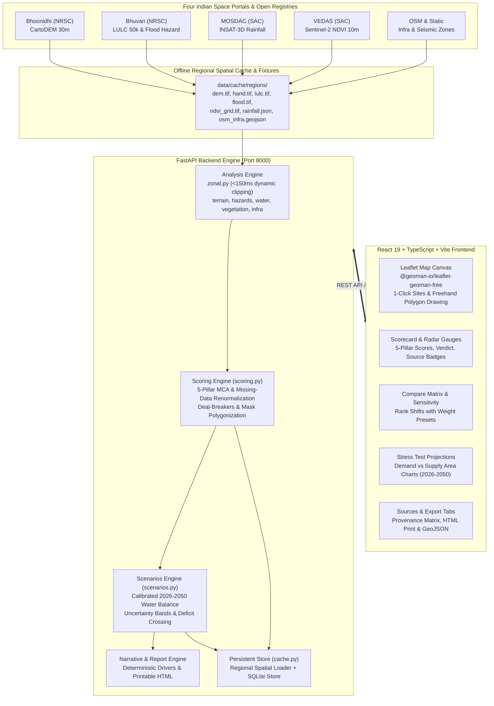

# TerraCity AI — Project Brief

**Space-Driven Greenfield Urban Site Screening & Resilience Stress-Testing**  
*Built for the ASTRA 2026 Hackathon (ANTERiX, VIT Bhopal — Theme: Space)*

---

## 1. Executive Goal

TerraCity AI is an open, explainable geospatial decision-support platform designed to assist state planning authorities, urban development boards, and infrastructure planners in evaluating candidate land parcels for new greenfield cities or industrial townships in India. It screens prospective sites against 5 foundational pillars using Indian Earth Observation data and stress-tests their viability under projected 2026–2050 water demand, monsoon volatility, and climate-induced flood inundation.

Planners can either load pre-configured regional candidate sites or draw custom polygon boundaries directly onto an interactive map to receive:
1. **Multi-Criteria Suitability Scorecard**: Scored 0–100 across 5 pillars (Terrain & Land, Water Security, Hazard Risk, Environmental Impact, Infrastructure Access) with source badges, derivation methods (direct / derived / proxy), and confidence levels.
2. **Transparent Multi-Site Comparison**: Side-by-side comparative ranking explaining *why* one parcel outperforms another from underlying numeric drivers, with live sensitivity toggles across 3 planner priority presets (*Balanced*, *Climate-Resilient*, *Infra-First*).
3. **Calibrated 2026–2050 Stress Test**: Physical water balance simulation tracking urban population expansion (150,000 Phase-1 baseline scaling up to 500,000 by 2050), municipal demand (135 lpcd standard), local rainwater catchment harvesting, aquifer recharge, and external canal allocations under baseline, moderate warming (+1.5°C), and high-stress drought (+2.5°C) trajectories.
4. **Spatial Deal-Breakers & Hazardous Sub-Mask Overlays**: Automated hard-stop disqualifications (e.g. >50% high Bhuvan flood inundation, >15% wetland overlap, >30% slope >30%, compound Seismic Zone V + high landslide risk) that polygonize hazardous raster cells into translucent red map overlays.
5. **Printable HTML Report & GeoJSON Export**: One-click generation of standalone printable executive reports (with `@media print` CSS) and full GeoJSON FeatureCollections for downstream GIS workflows (QGIS, ArcGIS).

---

## 2. Hackathon Domain Alignment (ASTRA 2026)

TerraCity AI directly aligns with the following hackathon domains:

- **Domain 02 — Earth Observation & Satellite Applications (Primary / Strong)**:
  - Leverages high-resolution digital elevation models, multi-temporal optical imagery, and satellite-derived precipitation indices for land capability analysis and climate resilience.
- **Domain 03 — Space-Based Disaster Management (Strong)**:
  - Satellite flood inundation zonation (Bhuvan multi-year flood maps), CartoDEM HAND (Height Above Nearest Drainage) hydrologic flood proxies, GSI landslide susceptibility inventories, and BIS IS 1893 seismic risk evaluation.
- **Domain 01 — Indian Space Missions & Space Data (Core Bonus Qualification)**:
  - Utilizes authentic satellite data from ISRO missions: Cartosat-1 (CartoDEM 30m stereo pairs), Resourcesat-2/2A (LISS-III / LISS-IV thematic layers), INSAT-3D/3DR (precipitation hydro-estimator products), and Sentinel-2 (via VEDAS).

*Note: In accordance with hackathon guidelines, TerraCity AI makes no claims toward satcom or navigation domains (Domains 04, 05, or 06).*

---

## 3. Four-Portal Provenance Guarantee

TerraCity AI satisfies the Indian Space Portal requirement by ensuring all four official Indian geoportal systems supply active, non-missing data to scored indicators in the primary demonstration region:

| Portal | Operating Agency | Satellite / Sensor Mission | Core Dataset Utilized | Indicators Supplied to MCA Scorecard |
| :--- | :--- | :--- | :--- | :--- |
| **Bhoonidhi** | NRSC / ISRO | Cartosat-1 PAN Stereo | CartoDEM Version 3 R1 (30m) | `mean_slope_deg`, `buildable_slope_share`, `terrain_roughness_tri`, `elevation_relief_m`, `hand_flood_risk` |
| **Bhuvan** | NRSC / ISRO | Resourcesat LISS-III / Multi-Mission | Bhuvan 1:50k LULC & Flood Inundation Hazard Zonation | `dominant_lulc`, `wasteland_share`, `wetland_share`, `forest_clearing_penalty`, `flood_hazard_score`, `groundwater_prospects` |
| **MOSDAC** | SAC / ISRO | INSAT-3D / 3DR Imager & Sounder | Hydro-Estimator Precipitation Climatology (10-Yr) | `rainfall_annual_mean`, `rainfall_cv`, `dry_months_count`, `drought_exposure_index` |
| **VEDAS** | SAC / ISRO | Sentinel-2 MSI (ISRO SAC Mirror) | Multi-Temporal NDVI & Vegetation Health Index (10m) | `ndvi_mean`, `vegetation_ndvi_trend` (Cross-validated against Bhuvan LULC classes) |
| **OpenStreetMap & Static** | OSM & BIS / GSI | Open Community & Geodetic Registries | Infrastructure Networks & IS 1893:2016 Zonation | `dist_road_km`, `dist_power_km`, `dist_social_infra_km`, `seismic_zone`, `landslide_risk` |

---

## 4. Honest Positioning & Targeted Gap

### What Existing Platforms Do
- **PM GatiShakti National Master Plan**: Unifies multi-modal infrastructure logistics and route planning across existing national transport corridors.
- **AMRUT 2.0 GIS Master Plans**: Develops comprehensive master planning and utility zoning for existing designated cities.
- **VEDAS Urban Sprawl Information System**: Monitors historical urban boundary sprawl and decadal growth trends of existing metropolitan centers.

### The Targeted Gap TerraCity AI Fills
TerraCity AI does not perform urban master planning, internal street layout design, or municipal zoning. Its targeted capability is **early-stage greenfield site screening**: comparing candidate land parcels for a new township across terrain buildability, water security, and multi-hazard exposure using Indian satellite data in one open, explainable platform.

---

## 5. System Architecture

---

## 6. Demonstrated Regions

1. **UP Jewar (Noida International Airport Greenfield Region) — Primary Demonstration**
   - **Location**: Gautam Buddha Nagar, Uttar Pradesh (`77.48°E - 77.68°E, 28.10°N - 28.28°N`).
   - **Data Coverage**: Full 4-portal coverage with authentic Bhuvan multi-year satellite flood inundation records along the Yamuna river buffer.
   - **Preset Sites**:
     - *Site A (Jewar North Greenfield)*: High buildable share, safe upland plain, top composite suitability.
     - *Site B (Jewar South Logistics Hub)*: Highway adjacent, moderate slope, balanced performance.
     - *Site C (Yamuna Floodplain Buffer)*: Low-lying lowland with seasonal inundation triggering the high flood hazard deal-breaker.

2. **Dholera Special Investment Region (SIR) — Secondary Demonstration**
   - **Location**: Gulf of Khambhat, Gujarat (`72.10°E - 72.35°E, 22.15°N - 22.35°N`).
   - **Role**: Demonstrates honest **CartoDEM HAND (Height Above Nearest Drainage) flood proxy fallback** when observational satellite flood history is sparse in arid coastal plains.

---

## 7. Corrections Found

*(Recorded during autonomous build and empirical inspection)*

1. **Shapely 2.0+ `ops.transform` Deprecation (2026-11-21)**:
   - *Observation*: Calling `shapely.ops.transform()` raised deprecation warnings in Python 3.15.
   - *Correction*: Replaced with modern vectorized `shapely.transform(geom, lambda c: np.column_stack(transformer.transform(c[:, 0], c[:, 1])))`.

2. **React Leaflet Draw Peer Dependency Conflict (2026-11-21)**:
   - *Observation*: `react-leaflet-draw` exhibits hard peer-dependency incompatibilities with modern React 18/19.
   - *Correction*: Successfully adopted `@geoman-io/leaflet-geoman-free` directly on the Leaflet map instance for seamless polygon drawing and editing.

3. **Indicator Key Mapping Alignment (2026-11-21)**:
   - *Observation*: Adapter raw keys (`slope_buildable_share`, `rainfall_variability_cv`, `dist_to_major_road_km`) had minor alias variations against `config/scoring.yaml` keys (`buildable_slope_share`, `rainfall_cv`, `dist_road_km`).
   - *Correction*: Implemented transparent bidirectional alias unification in `backend/app/api/analyze.py` so indicators map identically without missing-data penalties.
